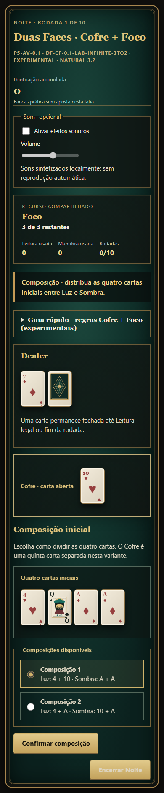

# Art direction, UX and audiovisual intent

**Art Déco / noir identity is RATIFIED.** Specific palette/fonts/logos/production assets are merely inspiration until visual review. **Core gameplay validation comes first.**

## Fantasy and atmosphere

A fictional sophisticated nocturnal card club above a dark city: geometric Art Déco architecture, black marble, brass/bronze, emerald felt, restrained wine accents, warmly lit typography, jazz-noir ambience. Menus should feel like distinct rooms or destinations, not a generic website dashboard.

Name **NOCTE** and subtitle/taglines ("Twenty-one is only the beginning", "The House of Twenty-One") are **provisional copy**, not final brand canon.

### Palette candidate (not finalized)

- Noir: `#0B0D12`; emerald `#153B37`; bronze `#C9A86B`; ivory `#EEE3D0`; wine `#702932`.
- Typography: modern, geometric Art Déco headings plus highly readable UI numbers; no actual font files canonized.
- Cards: unusually legible pips, totals and active-state highlights, with sober texture and bevel; clarity outranks ornament.

## Experience contract

- Game-like nearly full-screen canvas that responds to viewport, with optional browser fullscreen after user gesture.
- Browser plays without plugins; desktop and phone layouts; touch, mouse and keyboard operation.
- Player understands current step, legal actions, timer, both hand totals, dealer upcard and latest settlement **without** needing animations.
- Animation communicates consequence (cards recombine between hands, score shifts, dealer reveal), not only decoration.
- Color never carries the only game information; readable contrast, accessible focus order, reduced motion, volume and mute controls.
- Audio opt-in/controls: tactile card/chip cues and optional jazz-noir reactive layers. Verify asset licensing before use.
- Room socials: visible participants, expressive but unobtrusive reactions, recap after each Noite, *Mão da Noite* / *Estrategista* highlights (candidate).
- Optional decorative customization and cosmetic unlocks should never affect competitive odds.

## Technology candidate

React/Vite UI with CSS+SVG; Motion / Web Animations API for transitions, Howler.js/Web Audio API for layered sound; PixiJS is a **later optional** rendering subsystem, not initial dependency. No Unity/Godot requirement and no visual engine entanglement with pure rules logic.

## Phasing

1. Paper-like minimal interface to test composition and choices.
2. Functional social room HUD and accessible menus.
3. Designer-quality art/UI animations, audio systems, accessibility polish, identity.
4. Optional characters, ambience, more sophisticated visual effects and seasonal scenes.

## Avoid compulsion patterns

No pressured countdowns for daily claims, sold mystery bonuses, artificial near-misses, notifications to induce repeated betting or purchases to recover from losses. Reward meaningful strategic mastery and social fun; ability to leave/rejoin is normal.

## P5 audiovisual lab — Issue #35, Marco 1 (2026-10-23)

N-056 records the founder-approved creative direction and authorizes the isolated **P5-AV-0.1** presentation experiment. The browser's new P5 solo mode uses original inline SVG court figures, four suit symbols, an NOCTE geometric back, a layered emerald/bronze table, restrained state-transition animation, and synthesized local Web Audio cues. Audio starts disabled; the player explicitly activates it and may change volume. Reduced-motion preference shortens animation. Earlier modes and the P2A study remain available with their existing layouts and protocols. This first visual slice is explicitly no-stakes practice; A1a bankroll play belongs to the separate Marco 2 implementation.

The underlying engine card continues to carry only its aggregated mathematical rank (10 represents 10/J/Q/K); optional art.faceRank and art.suit are display metadata. P5 presentation metadata is derived from a separately versioned SHA-256 counter stream (sha256-counter-p5-art-v1) namespaced by seed/index/draw lane. The existing sha256-counter-rejection-v1 rank stream and its calls do not change. In the 13-bucket model, each rank bucket retains probability 1/13, four ten-value buckets retain total probability 4/13, and the separate uniform face/suit mapping gives 1/52 per displayed rank/suit identity. This remains an infinite-with-replacement value model, not a finite physical shoe. No human usability, audio, aesthetic, balance, or enjoyment result is claimed.

P5 visuals render only projected cards. The dealer hole card remains omitted from public projections until legal Leitura or terminal reveal; future dealer draws remain unavailable until completion. The browser mode remains a local experimental prototype and is not server-authoritative. A1a stake play, goals/acts, cosmetic unlocks, persistent balance, purchase/store and multiplayer are outside this first PR.

Playwright visual evidence, 390 × 844 viewport, deterministic local fixture and reduced-motion preference:

